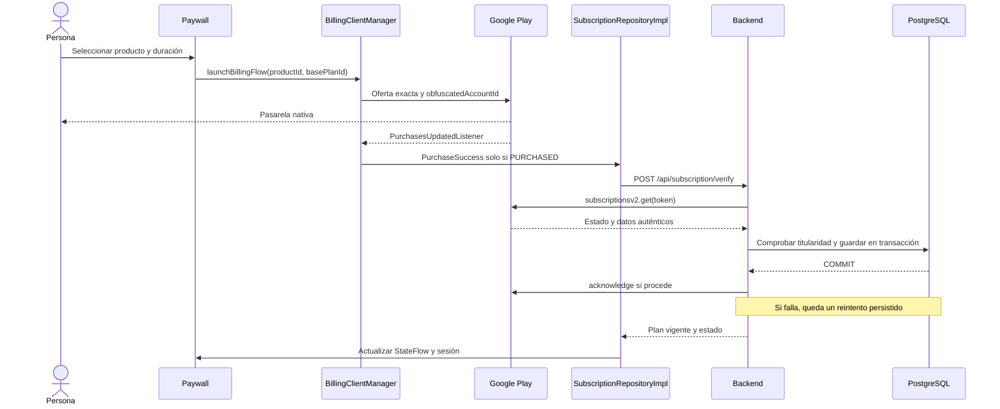

# Suscripciones, compras y gestión

Revisión: 2026-10-23. Descripción contrastada con el código y las comprobaciones de esta sesión. No certifica el despliegue ni una compra completa reconocida por Google.

[Guía maestra](../../guia-maestra.md) | [Mapa de funcionalidades](../funcionalidades.md) | [Backend: pagos, persistencia y operación](../../../../MiraiLink-Backend/docs/payments-google-play.md)

El enlace al backend supone los dos repositorios como directorios hermanos. Si se consulta este repositorio aislado, abrir `docs/payments-google-play.md` en MiraiLink-Backend.

## 1. Responsabilidades y conceptos

| Componente | Responsabilidad |
| --- | --- |
| Google Play | Ofertas elegibles, pasarela nativa, cobro, renovación y estado de compra |
| BillingClientManager | Conexión con Play, consulta de productos/compras y lanzamiento del producto y plan exactos |
| SubscriptionRepositoryImpl | Envío del token al servidor, recuperación, estado observable y sesión Plus/Premium |
| SubscriptionPaywallViewModel | Selección, progreso, errores localizados y eventos de interfaz/analítica |
| MainActivity | Recuperación al volver a primer plano e iniciar sesión |
| Backend | Verificación con Google, vinculación a cuenta, derechos, persistencia y reconocimiento |
| PostgreSQL | Plan vigente, titularidad de tokens, sustituciones y reintentos persistidos |

**Pago aceptado, compra verificada y compra reconocida son etapas distintas.** Abrir la pasarela tampoco significa que se haya pagado. El backend puede verificar y conceder acceso mientras el reconocimiento está pendiente de reintento. La app no ejecuta `acknowledgePurchase()`: el reconocimiento lo realiza el servidor.

## 2. Productos y planes

Package: `com.feryaeljustice.mirailink`. Productos: `mirailink_plus` y `mirailink_premium`.

| Duración | Plus | Premium |
| --- | --- | --- |
| Semanal | weekly-autorenew | weekly-autorenew |
| Mensual | monthly-autorenew | monthly-autorenew |
| Trimestral | three-month-autorenew | threee-month-autorenew |

La grafía con tres letras e del trimestral Premium existe en el catálogo observado. No corregir identificadores unilateralmente.

La app obtiene `ProductDetails`, ofertas y `offerToken` de Play. Hay precios de respaldo en `mapOffers` para presentar la interfaz; no acreditan precio real ni disponibilidad. El cobro depende de la oferta que Play presenta.

El lanzamiento exige producto y base plan exactos y token de oferta no vacío. Si falta alguno, devuelve `ITEM_UNAVAILABLE`, que el repositorio convierte en `SubscriptionError.PLAN_UNAVAILABLE`. El mensaje localizado informa de que el plan no está disponible. No se sustituye Plus por Premium, ni una duración por otra, ni una grafía de plan por otra.

## 3. Compra de principio a fin



1. `startPurchase` obtiene el producto/base plan de la oferta seleccionada y activa progreso.
2. Billing calcula SHA-256 del identificador de la cuenta MiraiLink y lo envía como `obfuscatedAccountId`. Requiere una cuenta disponible. La cuenta Google compradora y la cuenta MiraiLink tienen funciones distintas.
3. El resultado inmediato de `launchBillingFlow` solo confirma apertura o rechazo del flujo.
4. `onPurchasesUpdated` procesa éxito, cancelación o error de Play. `handlePurchase` solo emite compra para `PURCHASED`. `PENDING` no concede acceso.
5. El repositorio llama al backend autenticado. Solo reenvía el evento de éxito a la UI cuando esa verificación responde correctamente.
6. La respuesta actualiza `subscriptionInfo` y `GlobalMiraiLinkSession.setSubscriptionState`. Premium incluye Plus.
7. Las condiciones de expiración, sustitución y reconocimiento las decide el servidor con datos de Google.

## 4. Contrato cliente/servidor

Todas las rutas usan el prefijo `/api/subscription`. La base URL es configurable mediante `mirailink.baseUrl`, trasladado a `BuildConfig.MIRAILINK_BASE_URL`; hay que verificar el destino del APK que realmente se está probando.

| Ruta | Acción |
| --- | --- |
| GET /status | Consultar la proyección guardada del plan; no consulta Google en esa petición |
| POST /verify | Verificar token con Google y guardar/actualizar la suscripción |
| POST /cancel-intent | Registrar intención y devolver enlace de gestión de Play |
| POST /google-play-notifications | Entrada del servidor para notificaciones autenticadas de Pub/Sub; no la llama la app |

Las tres primeras rutas requieren autenticación MiraiLink. Ejemplo esquemático de verificación, con datos ficticios:

```json
{
  "purchaseToken": "<token-obtenido-de-Play>",
  "productId": "mirailink_plus",
  "basePlanId": "weekly-autorenew"
}
```

`orderId` es opcional. La app aún envía `monthly-autorenew` en recuperación/eventos de compra aunque la duración real sea otra. El controlador usa token y producto; el plan, pedido, vencimiento y renovación definitivos proceden de Google, no de ese valor informativo.

La respuesta pública del servidor contiene `isPremium`, `isPlus`, `plan`, `status`, `productId`, `basePlanId`, `expiresAt`, `autoRenewing`, `providerState`, `hasAccess` y `acknowledgementPending`. También actualiza `X-Subscription-Plan` en status/verify.

El DTO Android actual consume los ocho primeros campos. No expone `providerState`, `hasAccess` ni `acknowledgementPending` en su modelo de interfaz. Por tanto, la UI no distingue una compra verificada con reconocimiento aún pendiente.

## 5. Recuperación, desconexión y cierre de proceso

- MainActivity inicializa el repositorio incluso antes del login.
- Mientras la actividad está RESUMED, observa identidad, autenticación y demo. Al disponer de cuenta real, inicia conexión con Billing y restaura.
- El repositorio observa conexión de Billing, identidad, autenticación y demo. Cuando son válidos, consulta compras y verifica todos los tokens de productos soportados.
- Tras un resultado de error, repite a los 60 segundos; tras un resultado correcto, a los 3.600 segundos, mientras siga viva la corrutina del proceso.
- Cambiar de cuenta, desconectar Billing, cerrar sesión o entrar en demo cancela ese ciclo. No es un trabajo persistente del sistema operativo.
- Un Mutex serializa restauraciones. El listener puede verificar concurrentemente; el backend conserva sus bloqueos e idempotencia.
- Un fallo en un token no impide intentar los restantes. Si hubo errores, el resultado conjunto informa de error. Si no, usa la última respuesta verificada o consulta status si no había compras.
- Google Play conserva las compras entre ejecuciones. No se ha añadido almacenamiento local de tokens de pago.
- El botón Restaurar compras sigue disponible.

**Límite actual:** `queryActivePurchases` devuelve lista vacía si Billing no está listo o su respuesta falla. No distingue esos casos de ausencia de compras. Si después status responde bien, el siguiente ciclo periódico puede demorarse una hora. No hay garantía de reconocimiento en segundo plano si el proceso muere: para eso se necesitan RTDN y el worker del servidor configurados.

## 6. Cancelación, renovación y cambios de plan

Cancelar desde la app registra intención y abre la gestión de Google Play. No desactiva por sí mismo la renovación. El backend mantiene acceso durante el período pagado de una suscripción cancelada aún vigente.

Los cambios de estado se sincronizan mediante notificaciones y reconciliación del servidor. El acceso a partir de estado guardado puede quedar desactualizado hasta esa sincronización; el vencimiento sí se comprueba al proyectar el estado.

Google rechazó en el dispositivo un cambio de plan con `Please ensure the old subscription is acked before starting plan change`. Hay que resolver la verificación/reconocimiento de la compra anterior. La selección estricta implementada no constituye por sí sola un flujo completo de upgrade/downgrade: no se añadió aquí configuración de `SubscriptionUpdateParams` ni modos de sustitución. El backend sí conserva validación de `linkedPurchaseToken`.

## 7. Registro de cambios de esta sesión

Estos cambios se añadieron sobre modificaciones locales ya existentes. No atribuir a esta sesión todo el diff del repositorio.

| Archivo | Cambio realizado |
| --- | --- |
| BillingClientManager.kt | Retirar fallback de producto/oferta y alias trimestral en el lanzamiento; rechazar oferta sin token; corregir comentario sobre reconocimiento |
| SubscriptionRepositoryImpl.kt | Recuperación por conexión/cuenta, reintentos, exclusión mutua, restauración de todos los tokens y error PLAN_UNAVAILABLE |
| MainActivity.kt | Restauración al reanudar y autenticar; sustituir la consulta aislada anterior de status |
| domain/error/AppError.kt | Nuevo SubscriptionError.PLAN_UNAVAILABLE |
| ui/error/AppErrorUiMapper.kt | Mensaje específico de plan no disponible |
| values/strings.xml | Texto del nuevo aviso |
| BillingClientManagerTest.kt | Producto ausente, plan/duración ausente y lanzamiento de coincidencia exacta |
| SubscriptionVerificationTest.kt | Añadir reconexión/logout, reintento y restauración de varios tokens con fallo parcial |
| Esta guía y guías del backend | Flujo, configuración, diagnóstico y límites |

Ya existían al comenzar: verificación del repositorio antes de comunicar éxito, vinculación ofuscada en Billing, diagnósticos de Play, cambios del paywall y parte del modelo de persistencia/reintentos del servidor. Las pruebas iniciales de rechazo/éxito de SubscriptionVerificationTest también estaban presentes. Los cambios de versión, dependencias, manifest, red y otros archivos locales no se atribuyen a estas correcciones.

## 8. Validación y diagnóstico real del 2026-10-23

- 27 pruebas Android seleccionadas: correctas. Incluyen 3 de BillingClientManager, 5 de SubscriptionVerification y pruebas de casos de uso, pantallas y clasificación de error seleccionadas por el filtro.
- APK debug generado correctamente.
- 48 pruebas seleccionadas del backend: correctas.
- Estilo de los archivos backend modificados, sintaxis y contrato OpenAPI de 77 operaciones: comprobados.
- Lint Android no completado: conflicto de restricciones/versiones de dependencias instrumentadas. No se declara lint aprobado.
- No se ejecutó una compra completa que terminara verificada y reconocida por Google. Las pruebas automatizadas usan dobles para Google y, en las seleccionadas del backend, para PostgreSQL.

En el dispositivo conectado se observó una compra existente, consulta de productos correcta y rechazo de cambio por reconocimiento anterior pendiente. Las verificaciones contra el backend local respondían 503 PLAY_UNAVAILABLE.

Diagnóstico directo de solo lectura con la configuración local:
- OAuth: 200.
- Consulta de la compra con subscriptionsv2.get: 401 permissionDenied.
- Cuenta de servicio del backend: coincide con la mostrada en la captura.
- Catálogo de suscripciones: 200.
- La captura muestra los permisos financieros y de gestión de pedidos marcados.

**Conclusión limitada:** existe un rechazo de autorización en la consulta de compras. No está demostrado que falten casillas de permisos ni que la causa sea propagación. No se cambiaron permisos, credenciales ni compras durante el diagnóstico. La evidencia de acceso al catálogo no garantiza acceso a pedidos. Los tiempos de propagación son una hipótesis que depende de cuándo se concedieron los permisos.

## 9. Reproducción y fuentes

Desde Android:

```powershell
.\gradlew.bat :app:testDebugUnitTest --tests '*Subscription*' --tests '*BillingClientManagerTest' :app:assembleDebug
.\gradlew.bat :app:lintDebug
```

Para aceptación real: cuenta compradora configurada como license tester, backend accesible y autorizado, compra de prueba PURCHASED, verify correcto, plan esperado, acknowledgementPending resuelto y estado reconocido en Google. Comprobar también cierre tras pagar, reapertura, desconexión, cancelación y vencimiento. No usar pagos reales para una prueba automática.

Código Android: [Billing](../../../app/src/main/java/com/feryaeljustice/mirailink/data/billing/BillingClientManager.kt), [repositorio](../../../app/src/main/java/com/feryaeljustice/mirailink/data/repository/SubscriptionRepositoryImpl.kt), [actividad](../../../app/src/main/java/com/feryaeljustice/mirailink/ui/MainActivity.kt), [API](../../../app/src/main/java/com/feryaeljustice/mirailink/data/remote/SubscriptionApiService.kt).

Fuentes oficiales:
- [Integración y reconocimiento](https://developer.android.com/google/play/billing/integrate)
- [Ciclo de suscripciones](https://developer.android.com/google/play/billing/lifecycle/subscriptions)
- [Pruebas y cuentas de licencia, incluido debug](https://developer.android.com/google/play/billing/test)
- [Cuenta de servicio y permisos](https://developers.google.com/android-publisher/getting_started)
- [Propagación de permisos de cuenta](https://developers.google.com/android-publisher/api-ref/rest/v3/users#DeveloperLevelPermission)
